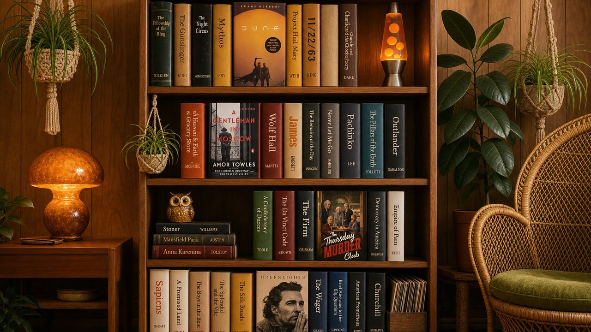
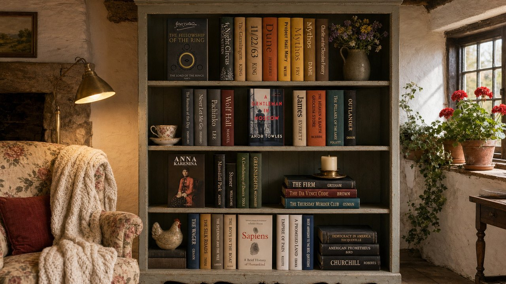

# kindle-wallpaper

Turns your Kindle library into a bookcase image you can use as a Google Meet background.



*Made with `kindle-wallpaper generate --theme 70s`.*



*A cosy cottage: `kindle-wallpaper generate --theme cottage`.*

## Setup

```sh
uv sync
# Only needed if Google Chrome isn't installed:
uv run playwright install chromium
```

## Usage

```sh
# 1. Fetch your library. A browser window opens; log in to Amazon there.
#    Your session is saved in .browser-profile/, so later runs skip the login.
uv run kindle-wallpaper fetch                  # use --domain amazon.co.uk etc. outside the US

# 2. Render the bookcase.
uv run kindle-wallpaper render                 # writes bookshelf.jpg (1920x1080)

# Try the renderer without logging in:
uv run kindle-wallpaper demo
```

Useful render options:

| Option | What it does |
| --- | --- |
| `--sort genre\|author\|title\|recent\|color\|random` | Shelf order. `color` gives a rainbow shelf. The default is `genre` after `curate` and `author` before it. |
| `--limit N` | Use only the first N books. Big libraries get small, hard-to-read spines. |
| `--shelves N` | Force the number of shelves. By default it picks the fewest that fit. |
| `--face-out-every N` | Show every Nth cover facing out. `0` turns this off. |
| `--seed N` | Generate a different random arrangement. |

| `--theme NAME` | Scene theme (see below). For `render`, it only picks the wood finish. |
| `--finish walnut\|oak\|mahogany\|white\|black` | Override the bookcase finish. |
| `--max-shelves N` | When not everything fits, use up to N shelves. Beyond that, keep the most notable books. |
| `--exclude-genres a,b` | Leave out genres, such as `children_ya,comics`. Needs `curate` first. |

## AI styling and rooms

```sh
export ANTHROPIC_API_KEY=...   # for curate
export OPENAI_API_KEY=...      # for room

# Claude (claude-opus-5-5) tags each book with genre, binding (leather, cloth, paperback...),
# typeface, spine color, a clean spine title and a "notability" score.
# Results are cached in data/styles.json, and re-runs only send new books.
uv run kindle-wallpaper curate

# Render now uses those styles automatically: shelves are grouped by genre, and when
# not everything fits, the most notable books win.
uv run kindle-wallpaper render

# Put the bookcase in an AI-generated room (gpt-image-1), saved as bookshelf_room.jpg.
uv run kindle-wallpaper room --theme cozy-study
uv run kindle-wallpaper room --theme auto          # Claude designs a room to suit your library
uv run kindle-wallpaper room --theme "sunny beach house"
```

By default the shelves have gaps for ornaments, which the image model fills with plants, a small lamp, vases, framed photos and candles. The room itself gets lit lamps, greenery and furniture on both sides of the bookcase.
`--bookcase-width 0.4` shows more room, and `0.6` shows more books. `--no-decor` fills the shelves with books only.

The image model only paints the room and the ornaments. The app pastes your bookcase back over the AI's version pixel for pixel, so titles are never garbled.
Rooms are cached in `data/rooms/`. Re-running with the same options reuses the saved room. Changing `--sort`, `--seed` or the book selection moves the ornament gaps, so it needs a new image.
Pass `--regenerate` to get a new room.

### Fully AI-generated scene

```sh
uv run kindle-wallpaper generate                        # → bookshelf_generated.jpg
uv run kindle-wallpaper generate --theme 70s --books 30 --exclude-genres children_ya
uv run kindle-wallpaper generate --reuse-plan           # keep the arrangement, paint again
```

In this mode the image model paints everything, including the books. Claude plans the shelves and the room, gpt-image-2 paints it, and the real covers of face-out books are sent as references. Claude then reads the image and scores how many titles are correct. If the score is low, it regenerates with notes on what went wrong (up to `--attempts`, default 3) and keeps the best attempt.
Every attempt, its prompt and Claude's check are saved in `data/generated/`.
This gives the most realistic look, but titles aren't guaranteed. Expect most of about 36 books to be right; fewer books means more reliable titles. If you need every title exact, use `room`.

Rough costs: `curate` is about $1–2 for ~900 books, and runs once. A high-quality room is a few tens of cents per image; `--quality medium` is cheaper.

## Themes

`--theme` sets the whole look: the room, the bookcase, the ornaments on the shelves and the photographic style.

| Theme | Look |
| --- | --- |
| `modern` | Bright and minimal: white shelving with LED strips, arc lamp, olive tree |
| `victorian` (or `old-fashioned`) | Carved mahogany, chesterfield, banker's lamp, brass and sepia |
| `70s` | Teak wall unit, orange and avocado, shag rug, macramé, lava lamp, film-photo colours |
| `mid-century` (or `60s`) | Walnut on tapered legs, sunburst clock, lounge chair |
| `art-deco` (or `1920s`) | Black lacquer and brass, emerald walls, velvet |
| `80s` | Memphis pastels, glossy laminate, halogen lamp, cassettes |
| `cottage` | Beams, stone fireplace, chintz, wildflowers |
| `industrial` | Brick, steel pipe shelving, Edison bulbs |
| `japandi`, `scandinavian` | Calm pale oak, paper lanterns, linen |
| `cozy-study`, `library`, `dark-academia` | Dark wood, lamplight, globes and busts |

You can also describe a theme in your own words: `--theme "1990s college dorm"` or `--theme "Hobbit hole"`.
Claude expands it into a room, a bookcase, ornaments and a photo style, once, and caches it in `data/themes/`.

## Using it in Google Meet

In a call, open **⋮ → Apply visual effects → Backgrounds → +** and upload `bookshelf.jpg`.
Meet mirrors your self-view, so the titles look backwards to you. Everyone else sees them the right way round.

## Notes

- The app never sees your Amazon password; you type it into Amazon's own login page. `.browser-profile/` holds your session cookies, so keep it private (it's in `.gitignore`).
- `fetch` reads the same library listing that the Kindle Cloud Reader (read.amazon.com) uses. If Amazon changes that endpoint, it falls back to scrolling and scraping the library page.
- Your data is written to `data/books.json` and `data/covers/`. You can edit `books.json` by hand (for example, to remove books) and then re-run `render`.
